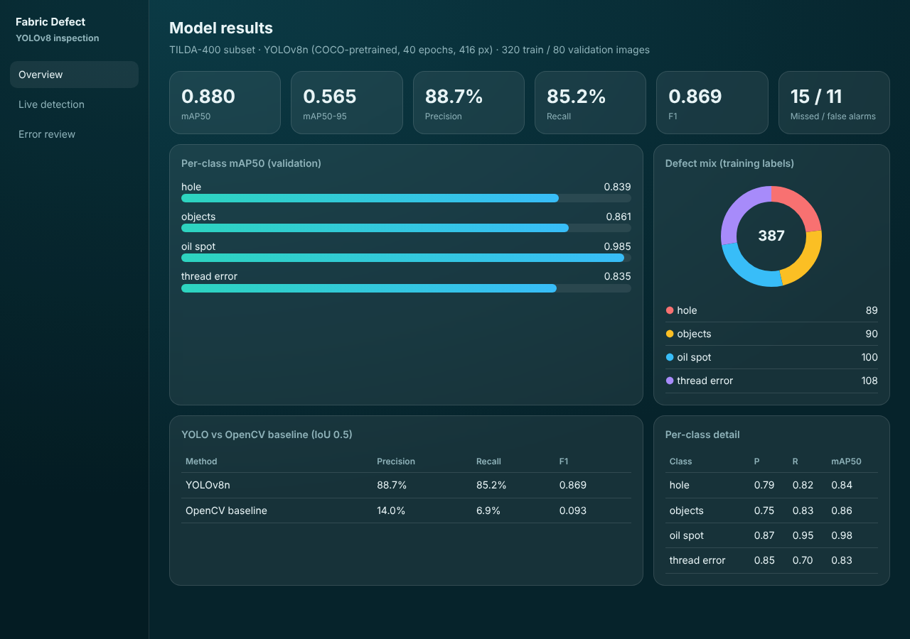
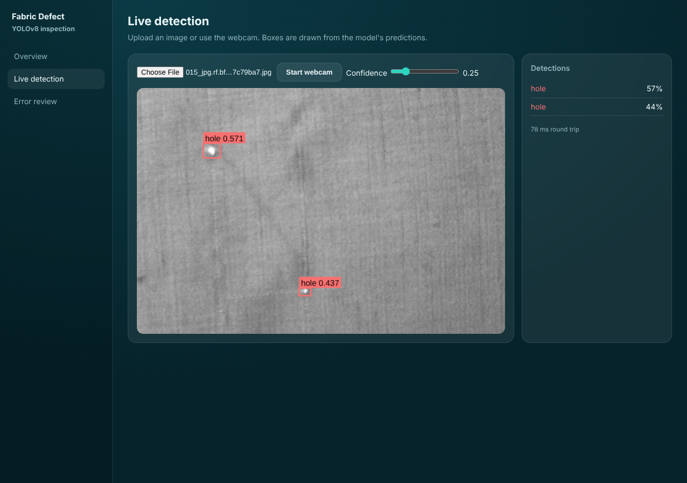

# Fabric Defect Detection (YOLOv8 vs OpenCV baseline)

Detects defects in fabric images with YOLOv8, compares it against a classical OpenCV baseline
under identical IoU-0.5 matching, and serves the model through FastAPI + Docker.

> Numbers come from `results/metrics.json`; do not edit them by hand.

## Dataset
- TILDA-400 subset (TILDA is a public textile research dataset) in YOLO format, taken from a public GitHub copy that has no licence file. Check the original TILDA terms before you publish; do not commit the images if unsure.
- 320 train / 80 val images, 4 classes: hole, objects, oil spot, thread error.
- Split: fixed seed, stratified by image, no image appears in both splits.

## Results (80 validation images, IoU 0.5, `results/metrics.json`)
YOLOv8n fine-tuned from COCO-pretrained weights: 40 epochs, 416 px, CPU, seed 0.

| Method | Precision | Recall | F1 |
|---|---|---|---|
| OpenCV baseline (median-blur difference) | 0.140 | 0.069 | 0.093 |
| YOLOv8n (conf 0.25) | 0.887 | 0.852 | 0.869 |

Ultralytics validation: precision 0.817, recall 0.827, mAP50 0.880, mAP50-95 0.565.

| Class | Val instances | mAP50 | mAP50-95 |
|---|---|---|---|
| hole | 23 | 0.839 | 0.434 |
| objects | 33 | 0.861 | 0.570 |
| oil spot | 20 | 0.985 | 0.778 |
| thread error | 25 | 0.835 | 0.479 |

Confusion matrix and curves: `results/training/`. Weights: `results/best.pt`.

## Error analysis
Looking at the misses and false alarms in `results/errors/` (green = ground truth, red = prediction), 15 defects were missed and 11 predictions were false alarms:
- **Tiny defects are missed.** Very small holes and specks, a few pixels across, produce no detection at 416 px.
- **Faint thin thread errors are missed or poorly located.** Long, low-contrast lines are the weakest class (recall 0.70).
- **Several "misses" are boxes that overlap the defect but fall below IoU 0.5**, where the predicted box is too small or too large. Thread errors and elongated objects are most affected by the strict IoU rule.
- The classical baseline fails mostly because fabric texture and lighting gradients create many false regions.

Next steps: train at 640 px or tile large images to help small defects, add more thin-defect examples, and tune the confidence threshold on a separate validation set.

## Dashboard
Run `uvicorn src.app:app --port 8000` and open http://localhost:8000. Pages: **Overview** (metrics, per-class results, defect mix, YOLO vs baseline), **Live detection** (upload an image or use the webcam, with an adjustable confidence slider) and **Error review** (missed and false-alarm images).




Regenerate the summary after retraining: `python src/make_summary.py results/best.pt data/fabric/data.yaml`.

## Run it
```bash
pip install -r requirements.txt
python src/mask2yolo.py IMG_DIR MASK_DIR data/fabric      # only if the dataset ships masks
python src/train.py data/fabric/data.yaml --weights yolov8n.pt --epochs 40 --imgsz 416   # GPU recommended
python src/evaluate.py runs/detect/fabric_pre/weights/best.pt data/fabric/data.yaml
```
API: `POST /predict` with an image file returns boxes, classes and confidences.
Docker: `docker build -t fabric . && docker run -p 8000:8000 fabric` (not yet built in my environment: please test once).
Tests: `pytest -q` (also run by GitHub Actions on every push).

## Limitations
Small dataset (320 train / 80 val), single split, no separate test set, a single seed, and images from one public dataset, so results will not transfer to real mill conditions without retraining. The validation set was also used to read these results, so treat them as indicative.
