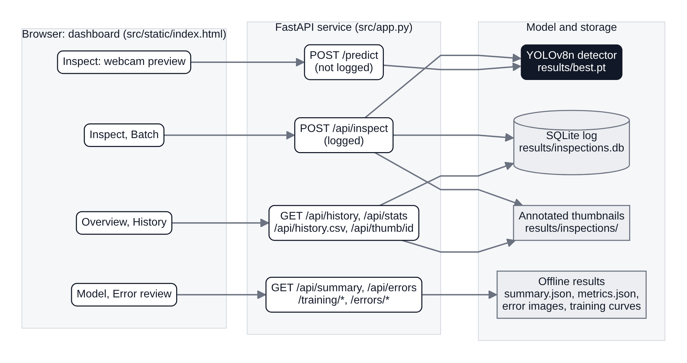
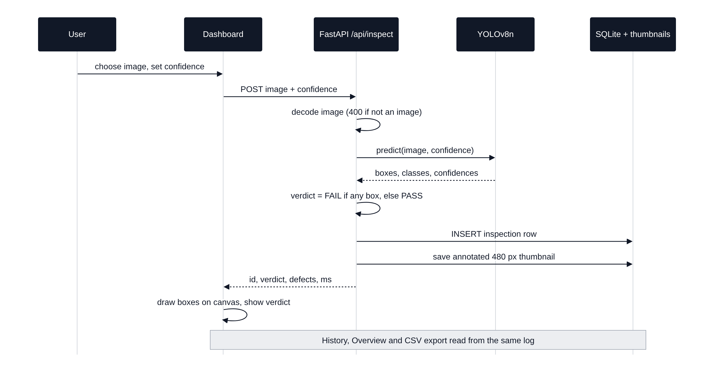
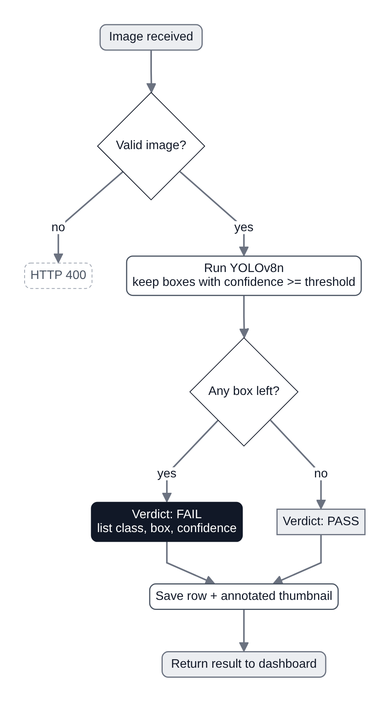
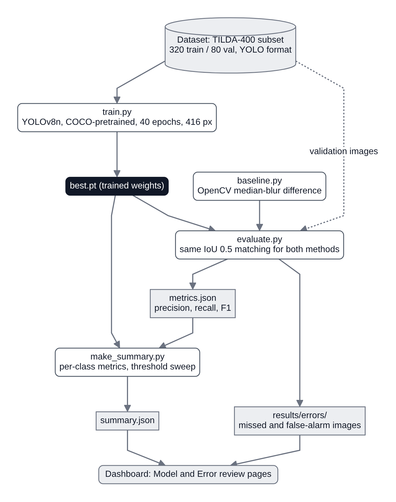
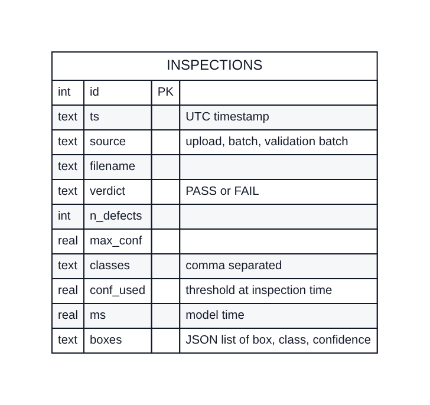

# Architecture

The system has three parts: an offline **ML pipeline** that produces the model and its evaluation, a **FastAPI service** that runs the model and keeps an inspection log, and a **browser dashboard** that talks to the service. Editable Mermaid sources for every diagram are in `docs/diagrams/*.mmd` (GitHub also renders them natively).

## 1. System architecture

- The dashboard is a single static page (`src/static/index.html`, plain HTML/JS, no build step) served by FastAPI.
- `POST /api/inspect` runs the detector **and** writes to the log. `POST /predict` only runs the detector and is used for the webcam preview so a live stream does not flood the log.
- Read endpoints (`/api/history`, `/api/stats`, `/api/history.csv`, `/api/thumb/{id}`) all read from the same SQLite log and thumbnail folder.
- Model results (`summary.json`, `metrics.json`, error images, training curves) are produced offline and served as static files.

## 2. What happens when you inspect an image

The model is loaded once on first use and kept in memory. The response includes the inspection id so the History page can show the same annotated thumbnail.

## 3. PASS / FAIL decision

The rule is deliberately simple: any detection at or above the confidence threshold makes the image FAIL. The threshold used is stored with each inspection, so past results stay interpretable if the threshold changes. The Model page shows the precision/recall trade-off for different thresholds.

## 4. ML pipeline (offline)

- `evaluate.py` scores YOLO **and** the classical OpenCV baseline with the same IoU 0.5 matching, so the comparison is fair.
- `make_summary.py` adds per-class metrics and a threshold sweep on the validation images for the dashboard.
- Missed and false-alarm images are saved for manual error analysis.

## 5. Data model

One table, `inspections`, in `results/inspections.db` (SQLite). Annotated thumbnails are stored as `results/inspections/{id}.jpg`. Neither is committed to the repository.

## Design decisions
| Decision | Why |
|---|---|
| YOLOv8n | Small and fast enough for CPU inference; good fit for a small dataset when fine-tuned from COCO weights |
| Compare against an OpenCV baseline | Shows what the learned model adds over a simple classical method |
| SQLite | Zero setup, one file, enough for a single-node inspection log |
| Static dashboard, no build step | Easy to run and review; the page only needs `fetch` and `canvas` |
| Separate `/predict` and `/api/inspect` | Keeps live previews out of the audit log |
