> This is the full technical write-up. The short version is in the [main README](../README.md).

<div align="center">

# Fabric Defect Inspection System

**Real-time textile defect detection with YOLOv8, a FastAPI inspection service, a persistent audit log and a web dashboard.**


</div>

**Live demo (no install):** https://ammaran620-de.github.io/Febric-Defect/ — the detector runs in your browser, so you can upload a fabric image and get a verdict straight away.

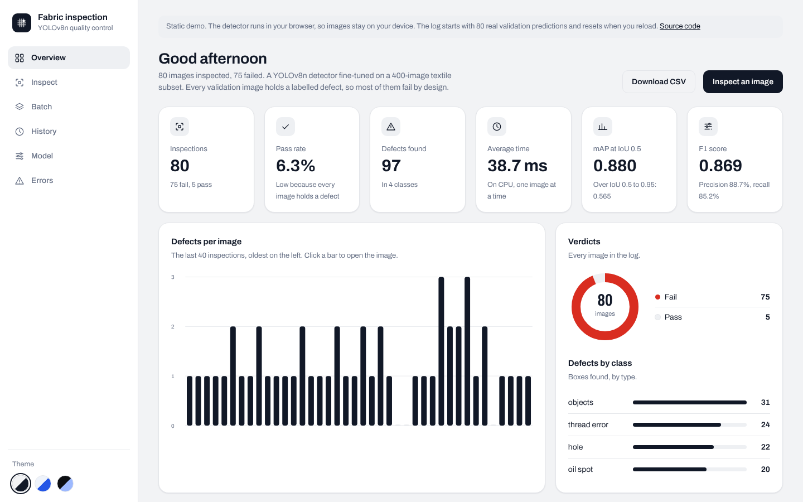

---

## Table of contents

1. [Overview](#1-overview)
2. [Headline results](#2-headline-results)
3. [Features](#3-features)
4. [Dashboard tour](#4-dashboard-tour)
5. [System architecture](#5-system-architecture)
6. [Tech stack](#6-tech-stack)
7. [Project structure](#7-project-structure)
8. [Getting started](#8-getting-started)
9. [Using the system](#9-using-the-system)
10. [API reference](#10-api-reference)
11. [Machine learning methodology](#11-machine-learning-methodology)
12. [Detailed results](#12-detailed-results)
13. [Error analysis](#13-error-analysis)
14. [Design decisions](#14-design-decisions)
15. [Testing and CI](#15-testing-and-ci)
16. [Limitations](#16-limitations)
17. [Roadmap](#17-roadmap)
18. [Dataset, licence and credits](#18-dataset-licence-and-credits)
19. [Author](#19-author)

---

## 1. Overview

Textile mills inspect fabric for holes, stains, foreign objects and weaving faults. Manual inspection is slow and inconsistent, and a missed defect usually means a returned roll. This project is an end-to-end **automated optical inspection (AOI)** prototype that covers the whole path from a camera frame to a decision a quality manager can audit:

1. **Detect** defects in a fabric image with a fine-tuned object detector.
2. **Decide** PASS or FAIL with an explicit, explainable rule.
3. **Record** every decision (verdict, defect classes, confidence, latency, annotated thumbnail) in a database.
4. **Review** the results in a dashboard with live inspection, batch inspection, history, model metrics and an error-review page.

The detector is YOLOv8n fine-tuned on a public fabric-defect dataset. It is evaluated against a classical OpenCV baseline on a held-out validation split using one fixed protocol, and the failure cases are inspected and documented rather than hidden.

> **Scope note.** This is a proof of concept trained on 400 images from a public dataset, on a CPU-only machine. It shows the engineering and evaluation workflow. It is not a production-qualified inspection line. See [Limitations](#16-limitations).

---

## 2. Headline results

Held-out validation split: 80 images, 101 labelled defects, 4 classes.

| Metric | YOLOv8n (this repo) | OpenCV baseline |
|---|---:|---:|
| Precision (conf 0.25, IoU 0.5) | **0.887** | 0.140 |
| Recall | **0.852** | 0.069 |
| F1 | **0.869** | 0.093 |
| mAP@0.5 | **0.880** | n/a |
| mAP@0.5:0.95 | **0.565** | n/a |
| Inference time (2-core CPU, no GPU) | about 40-60 ms per image | n/a |

Of the 101 labelled defects, the model finds 86, misses 15, and raises 11 false alarms. The classical baseline finds 7 and raises 43 false alarms, which is why a learned detector is justified for this task.

---

## 3. Features

**Detection and decision**
- YOLOv8n detector, COCO-pretrained and fine-tuned on four fabric defect classes
- Adjustable confidence threshold at request time
- Transparent verdict rule: any detection at or above the threshold means **FAIL**, otherwise **PASS**

**Service**
- FastAPI backend with a documented REST API and automatic OpenAPI docs at `/docs`
- Every logged inspection stores verdict, classes, confidence, latency, threshold and boxes
- Annotated 800 px thumbnails saved per inspection
- CSV export of the full inspection history
- Health endpoint for container orchestration

**Dashboard**
- Six pages: Overview, Inspect, Batch, History, Model, Error review
- Three themes: Light, Blue and Dark
- Overview shows six summary cards, defects per image for the last 40 inspections, the pass and fail split, defects by class, and the latest results
- Annotated thumbnails are 800 px wide and open full size on click
- Live webcam preview with bounding boxes, plus single-image and batch upload
- Charts drawn with inline SVG, so there are no front-end dependencies and no build step

**Engineering**
- Reproducible training and evaluation scripts with a fixed seed
- Classical baseline for an honest comparison
- Automated tests and a GitHub Actions workflow
- Dockerfile for containerised deployment

---

## 4. Dashboard tour

| Page | What it is for |
|---|---|
| **Overview** | Totals, pass/fail split, defects by class, inspections by source, recent activity |
| **Inspect** | Upload one image or use the webcam, adjust the threshold, see boxes and the verdict |
| **Batch** | Drop many images, get a verdict per file and a summary |
| **History** | Searchable log of every inspection with thumbnails and CSV export |
| **Model** | Precision, recall, mAP, per-class table, confusion matrix, training curves, confidence sweep |
| **Error review** | The actual false negatives and false positives from the validation set |

<table>
<tr>
<td width="50%">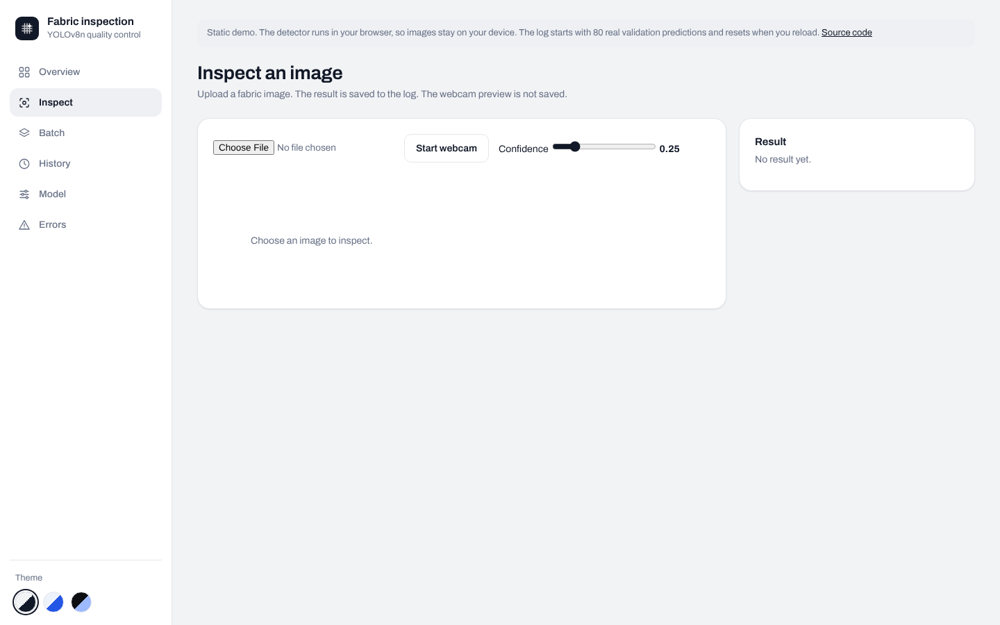<br><sub><b>Inspect</b>: single image or live webcam</sub></td>
<td width="50%">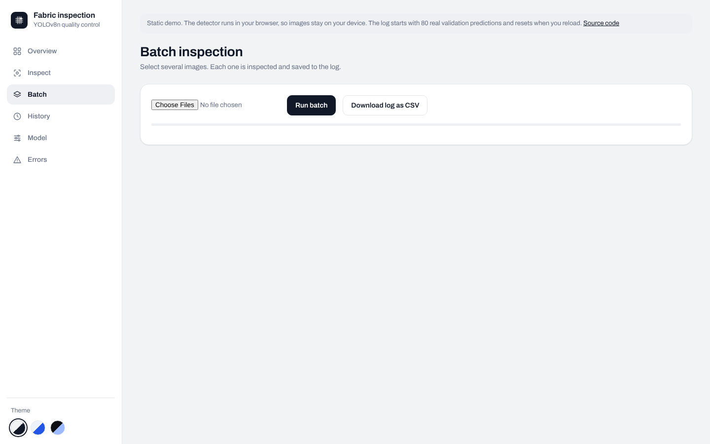<br><sub><b>Batch</b>: many images, one summary</sub></td>
</tr>
<tr>
<td width="50%">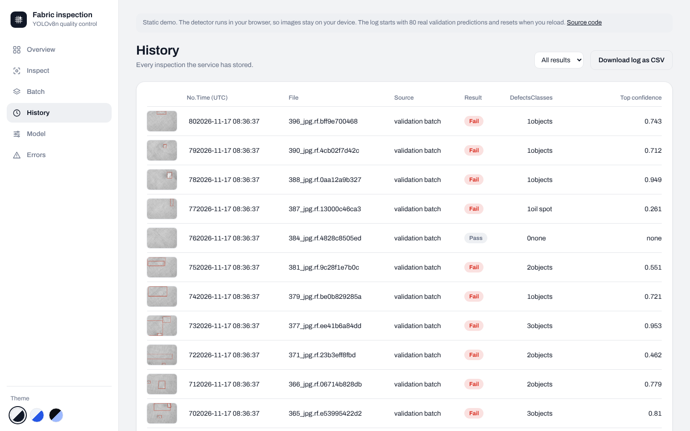<br><sub><b>History</b>: audit log with export</sub></td>
<td width="50%">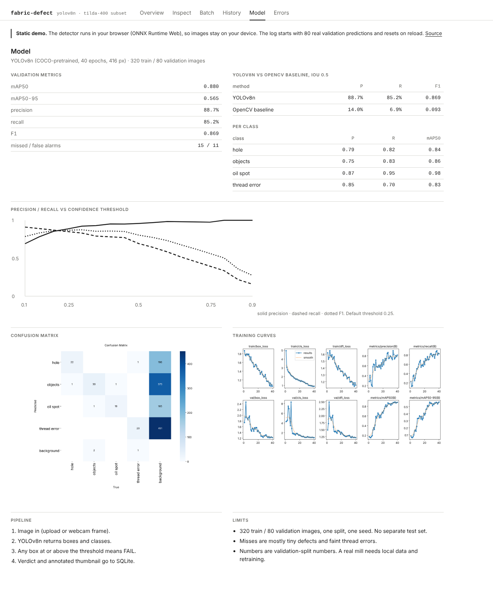<br><sub><b>Model</b>: metrics, per-class results, sweep</sub></td>
</tr>
<tr>
<td colspan="2">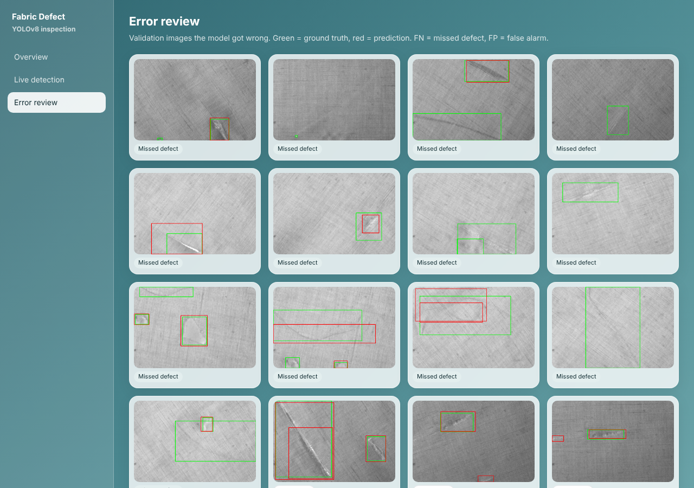<br><sub><b>Error review</b>: green is ground truth, red is the model's prediction</sub></td>
</tr>
</table>

Three themes (Light, Blue and Dark) switch from the circles at the bottom of the sidebar, and the choice is remembered. Red is used only for defects and FAIL. Click any thumbnail to open it full size.

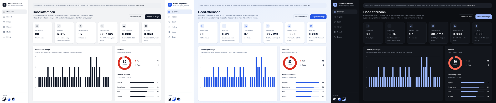


---

## 5. System architecture

The system has three layers: a **client** (browser dashboard), a **service** (FastAPI with the model loaded once at start-up) and a **store** (SQLite plus a thumbnail folder). The ML artefacts are produced offline by the training pipeline and loaded by the service as a single weights file.

### 5.1 System overview

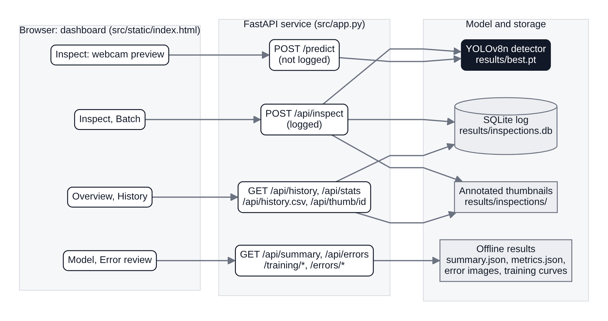

| Component | Responsibility |
|---|---|
| Dashboard (`src/static/index.html`) | Single-file front end. Calls the REST API, draws boxes on a canvas, renders charts as inline SVG |
| API (`src/app.py`) | Validates uploads, runs the detector, applies the verdict rule, writes the log, serves the dashboard |
| Model (`results/best.pt`) | YOLOv8n weights loaded once at start-up and reused for every request |
| Inspection log (SQLite) | One row per logged inspection, queryable and exportable |
| Thumbnails | Annotated 800 px JPEGs, one per logged inspection |
| Training pipeline | Offline scripts that produce the weights and the metrics shown on the Model page |

### 5.2 Request flow

What happens when a user submits an image from the Inspect page:

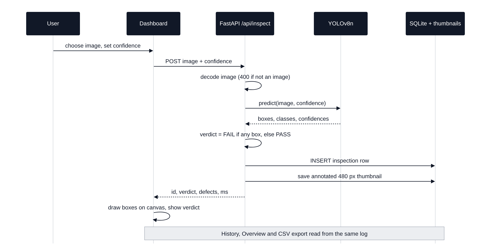

1. The browser sends the image and the chosen threshold to `POST /api/inspect`.
2. The API decodes and validates the image. A non-image returns an error and nothing is logged.
3. The model runs once and returns boxes, classes and confidences.
4. The verdict rule is applied.
5. The inspection is written to SQLite and an annotated thumbnail is saved.
6. The API returns the verdict, defects, latency and image size. The dashboard draws the boxes and updates its statistics.

The webcam preview uses `POST /predict` every 600 ms. That route returns detections only and **does not write to the log**, so a live preview cannot flood the audit history.

### 5.3 Verdict logic

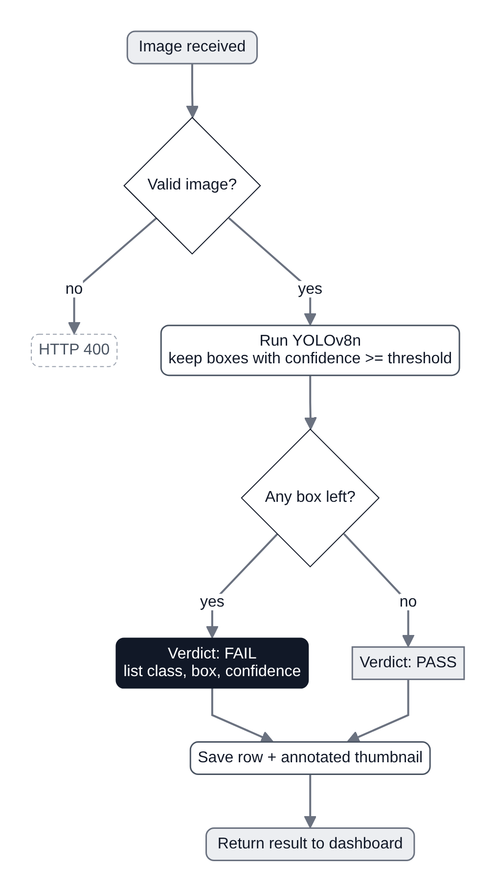

The rule is intentionally simple and auditable: if the model returns at least one box at or above the confidence threshold, the item **FAILS**; otherwise it **PASSES**. Raising the threshold trades recall for precision, and the [confidence sweep](#123-confidence-threshold-sweep) quantifies that trade so the threshold can be chosen with evidence.

### 5.4 Machine learning pipeline

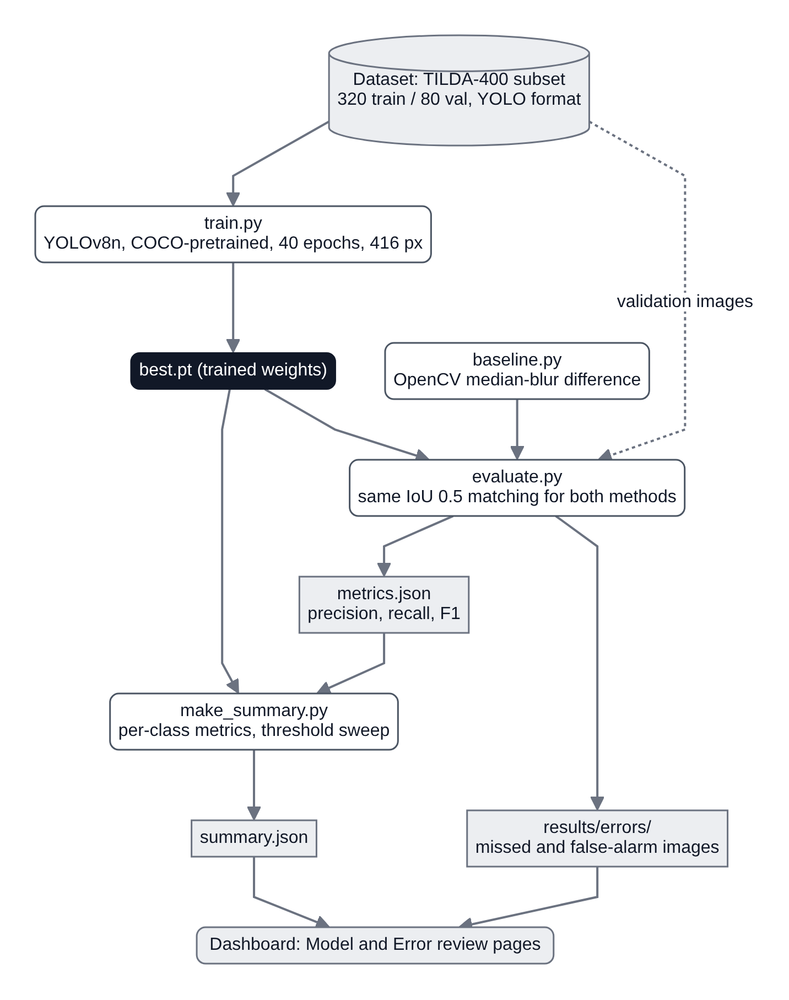

Dataset conversion, training, evaluation against the baseline, per-class summary and error export are separate scripts. Each writes a file the next step or the dashboard reads, so any stage can be re-run on its own.

### 5.5 Data model

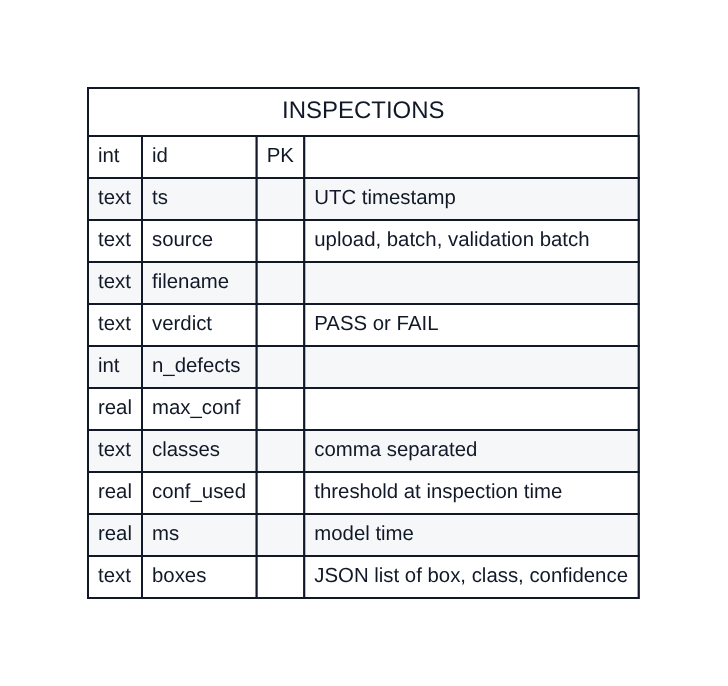

Table `inspections`:

| Column | Meaning |
|---|---|
| `id` | Auto-increment primary key |
| `ts` | Timestamp of the inspection |
| `source` | Where it came from (`upload`, `batch`, `validation batch`, and so on) |
| `filename` | Original file name |
| `verdict` | `PASS` or `FAIL` |
| `n_defects` | Number of boxes at or above the threshold |
| `max_conf` | Highest confidence among those boxes |
| `classes` | Defect classes found |
| `conf_used` | Threshold used for this decision |
| `ms` | Model latency in milliseconds |
| `boxes` | Full box list as JSON |

A longer walkthrough of each diagram and the reasoning behind it is in [`docs/ARCHITECTURE.md`](ARCHITECTURE.md). The editable Mermaid sources are in [`docs/diagrams/`](diagrams).

---

## 6. Tech stack

| Area | Tools |
|---|---|
| Detection | Ultralytics YOLOv8n (8.4.x), PyTorch |
| Classical baseline | OpenCV (median-blur difference with thresholding and contours) |
| API | FastAPI, Uvicorn, python-multipart |
| Storage | SQLite (standard library) |
| Front end | Plain HTML, CSS variables and JavaScript, inline SVG charts |
| Testing | pytest, FastAPI TestClient, httpx |
| CI | GitHub Actions |
| Packaging | Docker (`python:3.11-slim`) |
| Diagrams | Mermaid, rendered to PNG |

---

## 7. Project structure

```
Febric-Defect/
├── src/
│   ├── app.py              FastAPI service: inference, verdict, logging, stats, static hosting
│   ├── static/index.html   Dashboard (single file)
│   ├── train.py            Fine-tune YOLOv8
│   ├── evaluate.py         YOLO vs baseline at IoU 0.5, writes metrics and error images
│   ├── baseline.py         Classical OpenCV detector used as a comparison
│   ├── make_summary.py     Per-class metrics, class counts and confidence sweep
│   ├── seed_history.py     Run the real model over a folder and log the results
│   ├── mask2yolo.py        Convert mask-style datasets to YOLO boxes (untested on real data)
│   └── synth.py            Synthetic data helper
├── results/
│   ├── best.pt             Trained weights
│   ├── metrics.json        YOLO vs baseline numbers
│   ├── summary.json        Per-class metrics and confidence sweep
│   ├── training/           Confusion matrix, curves, results.csv
│   └── errors/             Real false-negative and false-positive images
├── tests/test_app.py       API tests
├── docs/                   Screenshots, ARCHITECTURE.md, diagram sources and renders
├── .github/workflows/ci.yml
├── Dockerfile
├── requirements.txt
├── run.bat                 One-click start on Windows
└── LICENSE
```

---

## 8. Getting started

**Requirements:** Python 3.10 or newer and about 1 GB of free disk space for dependencies. No GPU is needed.

### 8.0 Live demo on GitHub Pages

The `docs/` folder is a static build of the dashboard that runs the model **in the browser** with ONNX Runtime Web (WebAssembly). Nothing is uploaded: images stay on your device. Open https://ammaran620-de.github.io/Febric-Defect/ and use Inspect, Batch or the webcam.

- The inspection log starts with the 80 bundled validation predictions and resets on reload.
- The first inspection takes a second or two while the 12 MB model loads. After that, inference took about 125 ms per image in headless Chrome on a 2-core CPU, single-threaded.
- **Checked against the Python model** on all 80 validation images: the same PASS/FAIL verdict on 80 of 80, 97 boxes against 97, and 96 of 97 boxes matching at IoU above 0.9. The browser version is a re-implementation of the pre- and post-processing, so tiny confidence differences are possible.
- Rebuild it after retraining: export the model with `yolo export model=results/best.pt format=onnx imgsz=416 opset=12 dynamic=True simplify=True`, then run `python src/build_static.py` (it needs the `onnxruntime-web` npm package for the runtime files).
- To publish: repository **Settings, Pages, Deploy from a branch, `main`, folder `/docs`**.

### 8.1 Windows (cmd)

```bat
git clone https://github.com/ammaran620-de/Febric-Defect.git
cd Febric-Defect
run.bat
```

`run.bat` installs the requirements and starts the server. Then open **http://localhost:8000**. Leave the window open while you use the dashboard.

Manual equivalent:

```bat
python -m pip install -r requirements.txt
python -m uvicorn src.app:app --port 8000
```

### 8.2 Linux and macOS

```bash
git clone https://github.com/ammaran620-de/Febric-Defect.git
cd Febric-Defect
python -m venv .venv && source .venv/bin/activate
pip install -r requirements.txt
python -m uvicorn src.app:app --port 8000
```

### 8.3 Docker

```bash
docker build -t fabric-defect .
docker run -p 8000:8000 fabric-defect
```

> The Dockerfile has not been built in the environment where this project was developed (no Docker daemon was available). It follows a standard pattern, but treat it as untested until you build it once.

### 8.4 Configuration

| Variable | Default | Purpose |
|---|---|---|
| `MODEL_PATH` | `results/best.pt` | Weights file to load |
| `DB_PATH` | `results/inspections.db` | SQLite file for the inspection log |

### 8.5 Troubleshooting

| Problem | Fix |
|---|---|
| Browser says **localhost refused to connect** | The server is not running. Start it with `run.bat` and keep the window open |
| `'uvicorn' is not recognized` | Use `python -m uvicorn ...` as shown above, which does not need uvicorn on PATH |
| `python` is not recognized | Install Python from python.org and tick **Add Python to PATH** during setup |
| Port 8000 already in use | Run with `--port 8001` and open `http://localhost:8001` |
| Webcam preview is blank | Allow camera access in the browser. Browsers permit the camera on `localhost` and HTTPS only |
| First inspection is slow | The first request warms up the model. Later requests take tens of milliseconds |

---

## 9. Using the system

**Inspect one image.** Open the Inspect page, choose an image, set the confidence threshold and run. The verdict, boxes and latency appear immediately and the result is added to the history.

**Live webcam.** Start the camera on the Inspect page. Frames are sent about every 600 ms and boxes are drawn over the video. The live preview is not logged. Capture a frame to log a real inspection.

**Batch.** Drop a set of images on the Batch page. Each gets a verdict and a summary is shown at the end. All files are logged with source `batch`.

**History.** Review past inspections with thumbnails, or download the whole log as CSV.

**Model.** See the metrics behind the detector, including the per-class table and the confidence sweep, so the threshold can be chosen deliberately.

**Demo data.** On first start the dashboard loads a bundled log of 80 real predictions on the validation split (`results/demo/`), so the Overview and History pages are not empty. It is copied to `results/inspections.db`, which is yours to add to or delete (delete it to reload the demo data). The demo thumbnails derive from TILDA, see [licence note](#18-dataset-licence-and-credits).

**Re-generate the demo data.** To rebuild a log from your own folder of images:

```bash
python src/seed_history.py data/tilda/images/val --source "validation batch"
```

---

## 10. API reference

Interactive docs are served at **`/docs`** (Swagger UI) when the server is running.

| Method | Path | Description | Logged |
|---|---|---|:---:|
| `GET` | `/health` | Liveness check | no |
| `POST` | `/predict` | Detections only, used by the live preview | no |
| `POST` | `/api/inspect?conf=0.25&source=upload` | Full inspection with verdict | **yes** |
| `GET` | `/api/history` | Recent inspections | no |
| `GET` | `/api/history.csv` | Full history as CSV | no |
| `GET` | `/api/stats` | Aggregates for the Overview page | no |
| `GET` | `/api/thumb/{id}` | Annotated thumbnail of an inspection | no |
| `GET` | `/api/summary` | Model metrics and sweep (from `summary.json`) | no |
| `GET` | `/api/errors` | List of false-negative and false-positive images | no |
| `GET` | `/` | Dashboard | no |

### Example: inspect an image

```bash
curl -X POST "http://localhost:8000/api/inspect?conf=0.25" -F "file=@sample.jpg"
```

Real response from the shipped model on a validation image (the same image submitted three times, which is why the average latency above includes the slow first request):

```json
{
  "id": 1,
  "verdict": "FAIL",
  "defects": [
    { "box": [138.6, 115.1, 174.0, 145.6], "confidence": 0.571, "class": "hole" },
    { "box": [338.4, 416.4, 362.4, 432.5], "confidence": 0.437, "class": "hole" }
  ],
  "ms": 32.5,
  "width": 768,
  "height": 512
}
```

`box` is `[x1, y1, x2, y2]` in pixels of the original image. `ms` is model time. The first request after start-up is much slower (about 1.5 s in testing) while the model warms up; later requests took about 30-40 ms here.

### Example: statistics

```json
{
  "inspections": 3,
  "failed": 3,
  "passed": 0,
  "defects": 6,
  "avg_ms": 529.7,
  "by_class": { "hole": 6 },
  "by_source": { "upload": 3 },
  "recent": [ ... ]
}
```

---

## 11. Machine learning methodology

### 11.1 Dataset

| Item | Detail |
|---|---|
| Source | TILDA textile texture database, 400-image subset in YOLO format, taken from the public repository `sivasgitt/ai-fabric-defect-detection` |
| Split | 320 train / 80 validation images |
| Classes | `hole`, `objects`, `oil spot`, `thread error` |
| Validation defects | 101 labelled boxes |

The validation images are never used for training. All reported metrics come from this split only.

### 11.2 Model and training

| Setting | Value |
|---|---|
| Architecture | YOLOv8n (nano) |
| Initialisation | COCO-pretrained `yolov8n.pt`, fine-tuned |
| Epochs | 40 |
| Image size | 416 |
| Device | CPU (2 cores) |
| Seed | 0 |

Training from scratch was tried first and failed (mAP@0.5 of 0.18 on 400 images). Fine-tuning pretrained weights is what produced the reported result. `src/train.py` defaults to larger settings (50 epochs, 640 px, batch 16) for use on better hardware.

### 11.3 Evaluation protocol

- A prediction counts as a true positive when its IoU with an unmatched ground-truth box of the same class is at least **0.5**.
- Precision, recall and F1 are computed at a fixed confidence of **0.25**.
- mAP@0.5 and mAP@0.5:0.95 come from the Ultralytics validator on the same split.
- The **same** images and matching rule are used for the YOLO model and the OpenCV baseline, so the comparison is like for like.

### 11.4 Baseline

`src/baseline.py` is a classical detector: subtract a median-blurred copy of the image, threshold the residual and take contours as candidate defects. It needs no training and works on simple, high-contrast flaws, but it cannot tell classes apart and fires on normal fabric texture, which is why its precision and recall are low.

---

## 12. Detailed results

### 12.1 Overall

| | Precision | Recall | F1 | TP | FP | FN |
|---|---:|---:|---:|---:|---:|---:|
| YOLOv8n (conf 0.25) | 0.887 | 0.852 | 0.869 | 86 | 11 | 15 |
| OpenCV baseline | 0.140 | 0.069 | 0.093 | 7 | 43 | 94 |

Ultralytics validator: precision 0.817, recall 0.827, mAP@0.5 0.880, mAP@0.5:0.95 0.565. These differ slightly from the table above because the validator averages over its own confidence curve while the table uses a single fixed threshold.

### 12.2 Per class

| Class | Precision | Recall | mAP@0.5 | mAP@0.5:0.95 |
|---|---:|---:|---:|---:|
| hole | 0.79 | 0.83 | 0.84 | 0.43 |
| objects | 0.75 | 0.83 | 0.86 | 0.57 |
| oil spot | 0.87 | 0.95 | 0.985 | 0.78 |
| thread error | 0.85 | 0.70 | 0.835 | 0.48 |

Oil spots score highest on every metric. Thread errors have the lowest recall, and holes the lowest mAP@0.5:0.95. A plausible reason is that thread errors are thin and holes are small, though this was not tested directly.

### 12.3 Confidence threshold sweep

The threshold is the main operating-point control. Raising it removes false alarms at the cost of missed defects.

| Confidence | Precision | Recall |
|---:|---:|---:|
| 0.25 (default) | 0.887 | 0.852 |
| 0.55 | 0.970 | 0.644 |

The full sweep from 0.1 to 0.9 is in `results/summary.json` and plotted on the dashboard's Model page. A mill that cannot tolerate a shipped defect should run a lower threshold and accept more manual re-checks. One that cannot tolerate false stoppages should run a higher one.

### 12.4 Training artefacts

`results/training/` contains `results.csv` (per-epoch losses and metrics), `results.png` (training curves) and `confusion_matrix.png`.

---

## 13. Error analysis

At the default threshold the model misses **15** of 101 defects and raises **11** false alarms. Annotated examples (19 images, green is ground truth, red is the prediction) are on the **Error review** page and in `results/errors/`.

What the numbers support:

- **Thread errors have the lowest recall** (0.70), consistent with thin defects that resemble normal weave.
- **Holes have the weakest box tightness** (mAP@0.5:0.95 of 0.43), so they are found more reliably than they are precisely outlined.
- A prediction at the right place but IoU just under 0.5 counts as both a miss and a false alarm, so some of the 26 errors may be correct detections with loose boxes. Check the Error review page to judge which.

Likely follow-ups: more training images of thin defects, higher input resolution for small holes, and per-class thresholds. These are hypotheses to test, not results.

---

## 14. Design decisions

| Decision | Reason |
|---|---|
| **YOLOv8n, not a larger model** | Runs in real time on CPU, which matters for deployment on commodity hardware near a production line |
| **Fine-tune from COCO weights** | With only 320 training images, scratch training reached mAP@0.5 0.18. Pretrained features lifted it to 0.88 |
| **Single-rule verdict** | An inspector can explain "a defect above threshold was found". No hidden scoring |
| **Threshold per request** | The operating point is a business decision, so it is a parameter, not a constant |
| **SQLite log with thumbnails** | Zero-ops persistence and an audit trail. Easy to swap for PostgreSQL later |
| **Separate `/predict` and `/api/inspect`** | Live preview traffic must not pollute the audit log |
| **Model loaded once at start-up** | Avoids per-request model load cost |
| **Single-file dashboard, no build step** | Nothing to install or bundle. Anyone can open and read the code |
| **Classical baseline included** | A learned model is only meaningful relative to a simple alternative |
| **Fixed seed and a documented protocol** | Results can be re-run and checked |

---

## 15. Testing and CI

Run the tests:

```bash
python -m pytest -q
```

`tests/test_app.py` covers:

- `GET /health` returns `{"status": "ok"}`
- `POST /predict` returns boxes for an image
- `POST /predict` rejects a non-image upload
- `POST /api/inspect` logs the inspection and `GET /api/stats` reflects it

The model is replaced with a stub in the tests, so they run in seconds and need no GPU. The tests pass locally.

A GitHub Actions workflow (`.github/workflows/ci.yml`) runs `pytest` on every push and pull request using Python 3.11. Check the **Actions** tab on GitHub for the current status.

---

## 16. Limitations

Being explicit about these matters more than a larger headline number.

- **Small, public dataset.** 400 images from TILDA. Real mills have different fabrics, lighting and defect types. Expect lower numbers on your own data until you retrain on it.
- **Four classes only.** Defects outside these classes are not detected.
- **Single validation split.** There is no cross-validation or confidence interval, and with 101 defects the per-class figures are noisy.
- **Lab-style images.** The dataset has uniform lighting. Real lines add vibration, motion blur, and shadows.
- **Hole localisation is loose** (mAP@0.5:0.95 of 0.43), so this is better at *finding* defects than measuring them.
- **CPU-trained at 416 px.** Higher resolution and longer training on a GPU would likely help small defects.
- **Not safety- or production-qualified.** There is no authentication, rate limiting, multi-user support or camera integration.
- **Docker image untested** in the development environment, and the webcam preview has not been verified across browsers.
- **`mask2yolo.py`** is untested on real mask-style datasets.

---

## 17. Roadmap

- [ ] Retrain on mill-captured images with a documented labelling guide
- [ ] Per-class confidence thresholds and a severity score
- [ ] Higher input resolution and tiling for small defects
- [ ] Cross-validation and confidence intervals on the metrics
- [ ] Camera and line-trigger integration for continuous inspection
- [ ] Authentication, roles and PostgreSQL for multi-user deployment
- [ ] Export to ONNX and benchmark on edge devices
- [ ] Roll-level reporting (defects per metre, defect maps)

---

## 18. Dataset, licence and credits

**Code licence.** MIT. See [`../LICENSE`](../LICENSE).

**Dataset.** The images and labels derive from the **TILDA textile texture database** (Workgroup on Texture Analysis of DFG). This project used a YOLO-format subset published at `sivasgitt/ai-fabric-defect-detection`. That repository does not state a licence, so the **dataset is not covered by this repository's MIT licence**, and the sample error images and dashboard screenshots that contain TILDA imagery are included for demonstration only. If you reuse the data, check the original TILDA terms. The trained weights are a derivative of that data.

**Tools.** [Ultralytics YOLOv8](https://github.com/ultralytics/ultralytics) (AGPL-3.0), FastAPI, OpenCV, PyTorch.

---

## 19. Author

**Ammara Noor**
BS Computer Engineering, NUTECH University, Islamabad (2022-2026)
Computer vision and machine learning

GitHub: [ammaran620-de](https://github.com/ammaran620-de)

Feedback, issues and suggestions are welcome.
